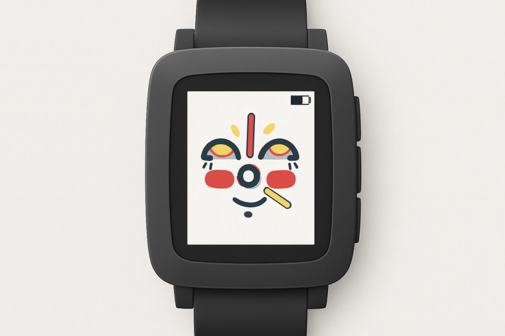

# facewatch

A Pebble watchface with a face that reacts to how much you've walked today. Published on the Rebble App Store.

**▶ Install:** https://apps.rebble.io/en_US/application/691cc106f5dd2700091a4fe2



## How it works

The face compares **today's step count** with **your average for this time of day** (Pebble Health):

- **Ahead of your average:** the face smiles, more broadly the further ahead you are
- **Behind your average:** the face gets sadder, with drooping eyelids and dark circles under the eyes
- **On track:** neutral face

The clock hands are part of the face, and the eyes blink every ~10 seconds. A battery indicator in the corner changes color as the charge drops.

## Highlights

- Written in **C** against the Pebble SDK 3, with all graphics drawn as vector shapes (arcs, rects, lines). No bitmaps.
- Separate layers for the face, eyes, hands and battery, so only the changed layer is redrawn (important for battery life)
- Animation timers for blinking, with mood interpolated from the step ratio (clamped to a 0–2× range)
- Runs on **aplite, basalt, chalk and diorite**: adapts hand lengths for rectangular vs. round displays, and has a black-and-white palette for B/W models
- Falls back gracefully on watches without Health support

## Project structure

```
src/c/
  main.c       window/layer setup, timers, battery + tick handlers
  drawing.c    face, eyes, hands and mood animation
  health.c     Pebble Health step metrics
  consts.h     per-platform sizes and color palette
```

## Building

Requires the Pebble SDK (e.g. via [pebble-tool](https://github.com/coredevices/pebble-tool)):

```bash
pebble build
pebble install --emulator basalt
```
